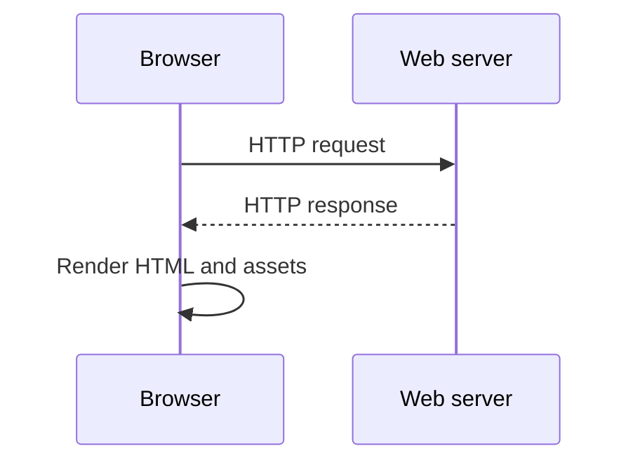

# Phase 01: Web Fundamentals

## Purpose and outcomes

Understand HTTP before introducing Java web technology. Explain how the browser, web server, application server, and database participate in a request.

## Place and prerequisites

This is the starting point. Use basic HTML, a browser with Developer Tools, and a local static server. Use fictional banking data only. There is no Servlet, Spring, or database code in this phase.

## Topics in order

1. Client/server architecture and URL parts.
2. HTTP methods, headers, status codes, query strings, bodies, and content types.
3. HTML forms and static versus dynamic content.
4. Browser Developer Tools and high-level TCP flow.

## Exercises

### 1. Customer registration form

- Objective: create a static form for fictional customers.
- Concepts: HTML forms, labels, GET, POST, input names.
- Tasks: create `customer-registration.html`; add name, email, and address; create GET and POST variants.
- Expected result: both forms render and submit.
- Acceptance: [ ] Every field has a label and `name`; [ ] submission is inspectable.
- Optional challenge: add client-side required-field validation.

### 2. Inspect requests

- Objective: see how browser actions become HTTP messages.
- Tasks: inspect GET query parameters and POST form data; compare `Content-Type` and headers.
- Expected result: write `docs/learning-notes/phase-01-http-request-lifecycle.md`.
- Acceptance: [ ] Explain where every submitted value appears.

### 3. Status codes and request flow

- Objective: connect outcomes to HTTP statuses.
- Tasks: observe success, redirect, missing-resource, and client-error responses; draw the complete request flow.
- Acceptance: [ ] Explain 200, 201, 302, 400, 404, and 500.

## Build, inspect, and common mistakes

Serve the directory with a local static server and use Network → Headers, Payload, and Response. Do not confuse a web server with a Servlet container or a query string with a POST body.

## Reflection, deliverables, and checklist

1. Which component creates the request and response?
2. Why can a GET be bookmarked while POST normally is not?

- [ ] HTML registration page.
- [ ] HTTP lifecycle notes and diagram.
- [ ] I can explain how a request is formed, transported, handled, and returned.

## Transition

The browser now needs Java code for dynamic requests. Phase 2 introduces Servlets and Tomcat.

## Official references

- [HTTP Semantics (RFC 9110)](https://www.rfc-editor.org/rfc/rfc9110)
- [MDN HTTP overview](https://developer.mozilla.org/en-US/docs/Web/HTTP/Overview)
