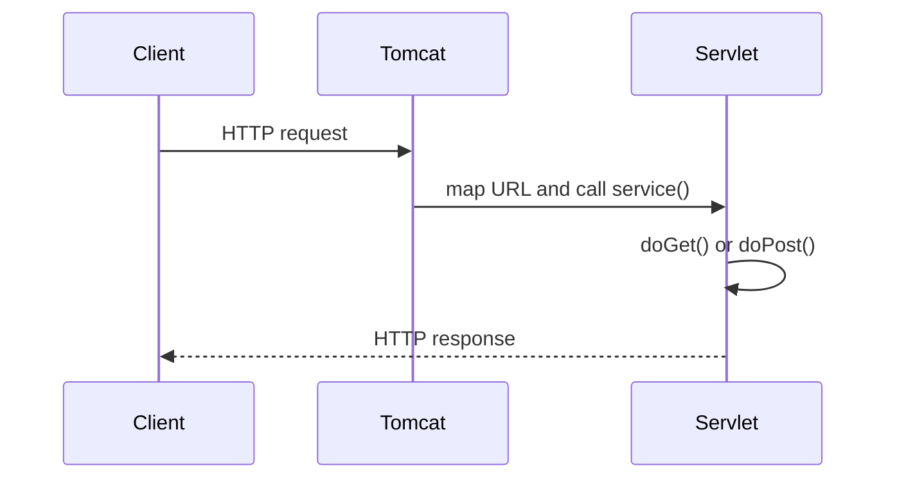

# Phase 02: Java Servlets

## Purpose and outcomes

Learn how Tomcat maps HTTP requests to Java classes, manages Servlet lifecycles, and produces responses.

## Place and prerequisites

Start from Phase 1. Use Java 21, Maven, Tomcat 10.1, and Jakarta Servlet 6.0 with `provided` scope. Use `jakarta.servlet.*`, never `javax.servlet.*`. This phase has no database, JSP, Spring, or ORM.

## Topics and flow

Servlet container; `Servlet`, `GenericServlet`, `HttpServlet`; request/response; `service`, `doGet`, `doPost`; mappings; WAR deployment; lifecycle; threading.

## Exercises

### 1. Maven WAR and deployment

- Objective: establish a repeatable Tomcat workflow.
- Tasks: create a WAR; add pinned Servlet API; package; deploy, undeploy, and redeploy on Tomcat 10.1.
- Expected result: context URL responds.
- Acceptance: [ ] WAR deploys; [ ] no `javax.*` dependency exists.
- Challenge: document external deployment versus Maven packaging.

### 2. HelloServlet and mappings

- Objective: understand URL-to-servlet mapping.
- Tasks: implement `HelloServlet`; map using `web.xml`; repeat with `@WebServlet`; compare.
- Acceptance: [ ] both mappings work independently.

### 3. Requests, responses, and lifecycle

- Objective: read request data and write correct responses.
- Tasks: implement GET/POST; read query parameters, form fields, and headers; set content type/status/header; log `init` and `destroy`.
- Acceptance: [ ] HTML response is valid; [ ] lifecycle callbacks appear in logs.

### 4. Customer endpoint

- Objective: create the first cumulative feature.
- Tasks: echo synthetic customer fields; send concurrent requests; inspect servlet instance reuse.
- Acceptance: [ ] values are echoed; [ ] thread-safety implications are explained.

## Build, run, and debug

Run `mvn package`, deploy the WAR, start Tomcat, and inspect `catalina` logs plus browser Network details. Avoid request-specific mutable fields and runtime Servlet dependencies for external Tomcat.

## Questions, deliverables, and checklist

- How does Tomcat select a servlet? Why may one instance serve concurrent requests?
- [ ] Working WAR and lifecycle notes.
- [ ] GET/POST endpoint and customer mini-project.
- [ ] Mapping and threading explanation.

## Transition

Servlets do not persist customer data, so Phase 3 adds PostgreSQL and JDBC without an ORM.

## Official references

- [Jakarta Servlet 6.0](https://jakarta.ee/specifications/servlet/6.0/)
- [Apache Tomcat 10.1](https://tomcat.apache.org/tomcat-10.1-doc/)
