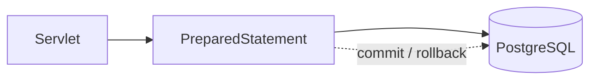

# Phase 03: JDBC and Database Integration

## Purpose and outcomes

Persist synthetic customers, accounts, and transactions using PostgreSQL and JDBC. Learn SQL, parameterization, resource management, and transaction boundaries without an ORM.

## Place and prerequisites

Start from the Phase 2 WAR. Use Java 21, Maven, PostgreSQL, and a pinned PostgreSQL JDBC driver. Do not introduce JSP, Spring, or JPA.

## Topics and architecture

Relational schema and SQL; `DriverManager`, `Connection`, `PreparedStatement`, `ResultSet`; CRUD; injection prevention; try-with-resources; commit/rollback; pooled `DataSource`.

## Exercises

### 1. Schema and connection

- Objective: connect the WAR to PostgreSQL.
- Tasks: create customer, account, and transaction tables; add the driver; create a connection utility; keep credentials external.
- Acceptance: [ ] Connection succeeds; [ ] schema can be recreated; [ ] credentials are not committed.

### 2. Customer CRUD

- Objective: implement safe persistence.
- Tasks: insert/retrieve customers with `PreparedStatement`; add update/delete; close resources with try-with-resources.
- Acceptance: [ ] CRUD works; [ ] no SQL concatenation; [ ] exceptions are handled.

### 3. Balance and transfer

- Objective: model a multi-row transaction.
- Tasks: implement balance enquiry; debit and credit in one connection; force failure between operations.
- Acceptance: [ ] success commits; [ ] failure rolls back both changes; [ ] insufficient funds is rejected.

### 4. Connection management

- Objective: understand pooling.
- Tasks: compare one connection per operation with a pooled `DataSource`; document lifecycle and cleanup.
- Acceptance: [ ] comparison exists; [ ] repeated requests do not leak connections.

## Build, run, debug, and mistakes

Apply the schema, configure local environment values, deploy the WAR, and inspect rows before and after rollback. Common mistakes are missing `commit`, closing resources too early, and string-concatenated SQL.

## Reflection, deliverables, and checklist

1. Why must debit and credit share one transaction?
2. What happens after a crash between the two updates?

- [ ] Schema/seed script.
- [ ] JDBC customer/account operations.
- [ ] Rollback demonstration.
- [ ] Pooling comparison.
- [ ] No ORM introduced.

## Transition

Servlets still mix request processing with HTML. Phase 4 introduces JSP, EL, and JSTL.

## Official references

- [JDBC API](https://docs.oracle.com/en/java/javase/21/docs/api/java.sql/module-summary.html)
- [PostgreSQL JDBC documentation](https://jdbc.postgresql.org/documentation/)
