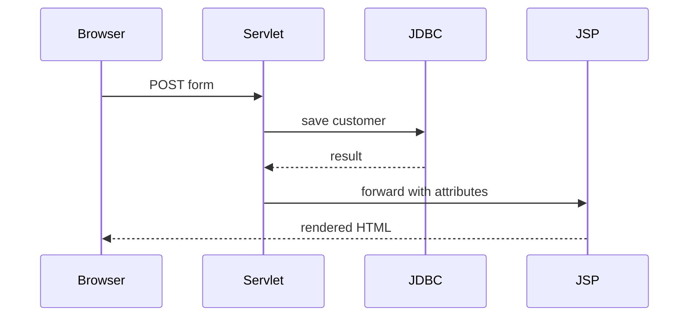

# Phase 04: JSP and Server-Side Rendering

## Purpose and outcomes

Move HTML presentation out of Servlets using JSP, Expression Language, and JSTL. Understand forwarding, redirecting, attributes, escaping, and early MVC separation.

## Place and prerequisites

Start from Phase 3. Verify JSP/JSTL versions against Tomcat 10.1. JDBC remains explicit; do not use Spring or JSP scriptlets.

## Topics and flow

JSP translation/lifecycle; Servlet versus JSP; request/session attributes; `forward`; `sendRedirect`; EL; JSTL; escaping; view/controller separation.

## Exercises

### 1. Form and forward

- Objective: process a JSP form with a Servlet.
- Tasks: create form JSP; submit to Servlet; put result in request attributes; forward to result JSP.
- Acceptance: [ ] Servlet has no HTML string generation.

### 2. EL and JSTL list

- Objective: display model data without scriptlets.
- Tasks: expose customers; iterate with JSTL; add validation and success/error messages; escape output.
- Acceptance: [ ] no `<% ... %>`; [ ] empty-list behavior is clear.

### 3. Forward versus redirect

- Objective: understand browser URL and POST/Redirect/GET.
- Tasks: implement both; inspect URL, refresh, and attribute behavior.
- Acceptance: [ ] Explain why request attributes do not survive redirect.

### 4. Customer mini-project

- Acceptance: [ ] Registration, listing, validation, and persistence work with Servlet + JSP + JDBC.

## Build, run, debug, and mistakes

Inspect request attributes, generated HTML, and JSP compilation logs. Avoid scriptlets, business logic in JSP, confusing session/request scope, and forwarding after committing a response.

## Deliverables and checklist

- [ ] Form and result JSPs.
- [ ] EL/JSTL customer list.
- [ ] Forward/redirect notes.
- [ ] Servlet + JSP + JDBC mini-project.

## Transition

Phase 5 formalizes presentation, service, and persistence responsibilities into independently testable layers.

## Official references

- [Jakarta Server Pages](https://jakarta.ee/specifications/pages/3.1/)
- [Jakarta Tags](https://jakarta.ee/specifications/tags/3.0/)
