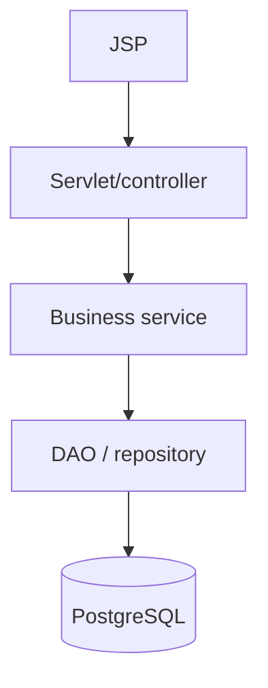

# Phase 05: Layered Architecture

## Purpose and outcomes

Separate HTTP handling, business rules, and persistence so each responsibility can evolve and be tested independently.

## Place and prerequisites

Start from the Phase 4 application. Use no framework. Know basic Java classes, interfaces, constructors, and JUnit 5.

## Topics and architecture

Presentation/controller; domain models and DTOs; service; DAO/repository; interfaces; manual wiring; validation; exception propagation; service tests.

## Exercises

### 1. Domain objects

- Objective: represent Customer, Account, and Transaction explicitly.
- Tasks: create focused models and DTOs where presentation differs; define invariants.
- Acceptance: [ ] models contain no SQL or HTTP code.

### 2. Extract repositories and services

- Objective: move responsibilities to appropriate layers.
- Tasks: move SQL to repositories; add services; keep Servlets thin; wire dependencies through constructors.
- Acceptance: [ ] no SQL or core business rules remain in Servlets.

### 3. Transfer rules and tests

- Objective: make business behavior testable.
- Tasks: implement `TransferService`; enforce amount/balance/ownership rules; use repository test doubles.
- Acceptance: [ ] tests run without Tomcat/PostgreSQL; [ ] success and failure are covered.

## Build, debug, and questions

Run unit tests separately from the WAR and trace one request across layers. Ask which layer owns validation and where persistence errors become application errors. Avoid “everything” classes and meaningless interfaces.

## Deliverables and checklist

- [ ] Domain models/DTOs.
- [ ] Repository and service layers.
- [ ] Constructor-wired application.
- [ ] Service unit tests.
- [ ] Layer diagram and responsibility notes.

## Transition

Manual wiring becomes repetitive. Phase 6 adds Servlet cross-cutting infrastructure, then Phase 7 builds a manual Front Controller.

## Official references

- [JUnit 5 User Guide](https://junit.org/junit5/docs/current/user-guide/)
- [Maven directory layout](https://maven.apache.org/guides/introduction/introduction-to-the-standard-directory-layout.html)
