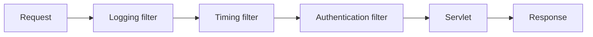

# Phase 06: Servlet Infrastructure and Web Security Fundamentals

## Purpose and outcomes

Learn Servlet API mechanisms for cross-cutting concerns: filters, listeners, context configuration, sessions, cookies, and educational authentication.

## Place and prerequisites

Extend Phase 5 before MVC or Spring. Security is synthetic and educational, not production-ready.

## Topics and flow

Filter/FilterChain and ordering; ServletContext/Config; listeners; HttpSession/cookies; authentication versus authorization; timeout/logout; thread safety; hashing, CSRF, secure cookies, session fixation.

## Exercises

### 1. Logging and timing filters

- Objective: understand FilterChain and order.
- Tasks: log method/path; measure duration; configure URL patterns; verify success and failure.
- Acceptance: [ ] each filter calls the chain exactly once; [ ] logs contain method/path/duration.

### 2. Session login

- Objective: maintain an authenticated identity.
- Tasks: use fictional users; store identity in `HttpSession`; protect account pages; implement logout/invalidation.
- Acceptance: [ ] anonymous access is blocked; [ ] logout removes access; [ ] no real password is used.

### 3. Lifecycle and timeout

- Objective: observe context and session lifecycle.
- Tasks: implement `ServletContextListener`; configure timeout; inspect cookies and session IDs.
- Acceptance: [ ] startup/shutdown and timeout are demonstrated.

### 4. Concurrency and limitations

- Objective: identify shared state and security gaps.
- Tasks: issue simultaneous requests; document races; explain production protections for hashing, CSRF, cookies, and fixation.
- Acceptance: [ ] limitations are explicit.

## Debugging, questions, and checklist

Ask how filter order changes behavior and what invalidation does. Distinguish filters from controllers.

- [ ] Logging, timing, auth, logout, and timeout work.
- [ ] Filter-chain/lifecycle diagram saved.
- [ ] Educational security warning included.

## Transition

Phase 7 centralizes feature routing with a manual Front Controller, exposing the mechanism behind Spring MVC.

## Official references

- [Jakarta Servlet Filter API](https://jakarta.ee/specifications/servlet/6.0/apidocs/jakarta.servlet/jakarta/servlet/Filter.html)
- [OWASP Session Management](https://cheatsheetseries.owasp.org/cheatsheets/Session_Management_Cheat_Sheet.html)
