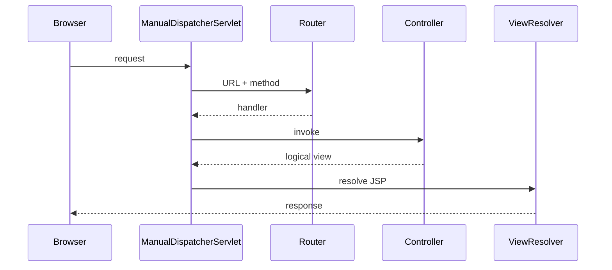

# Phase 07: Manual MVC and Front Controller

## Purpose and outcomes

Implement the central routing, handler invocation, view resolution, and error handling that Spring MVC later provides.

## Place and prerequisites

Use the Phase 6 Servlet application and no Spring. Study MVC, Front Controller, URL/method routing, handler abstractions, logical views, and centralized errors.

## Exercises

### 1. Central entry point

- Objective: route all application URLs through one Servlet.
- Tasks: create `ManualDispatcherServlet`; define handler interfaces; route Customer and Account paths.
- Acceptance: [ ] feature requests enter one front controller; [ ] unknown routes have a deliberate response.

### 2. Mapping and invocation

- Objective: separate mapping from invocation.
- Tasks: map URL + method; pass request/response context; return logical view names; handle unsupported methods.
- Acceptance: [ ] correct handler is called; [ ] mismatches are centralized.

### 3. View resolution and errors

- Objective: centralize presentation and failures.
- Tasks: forward logical views to JSP; add exception handling; compare the flow with Spring MVC.
- Acceptance: [ ] controllers do not know JSP paths; [ ] errors are consistent.

### 4. Banking mini-project

- Acceptance: [ ] Customer and Account flows use the manual dispatcher without one Servlet per feature.

## Build, debug, and mistakes

Deploy the WAR and trace mapping, handler selection, invocation, and forwarding. Keep business rules out of the dispatcher and prevent silent route fall-through.

## Reflection, deliverables, and checklist

1. Which responsibilities belong to infrastructure?
2. What could later become configuration or annotation metadata?

- [ ] Dispatcher, router, handlers, and view resolver.
- [ ] Centralized errors.
- [ ] Spring MVC comparison note and lifecycle diagram.

## Transition

Phase 8 removes repetitive object construction with a deliberately small DI container.

## Official references

- [Spring MVC DispatcherServlet](https://docs.spring.io/spring-framework/reference/web/webmvc/mvc-servlet.html)
- [Jakarta Servlet API](https://jakarta.ee/specifications/servlet/6.0/)
