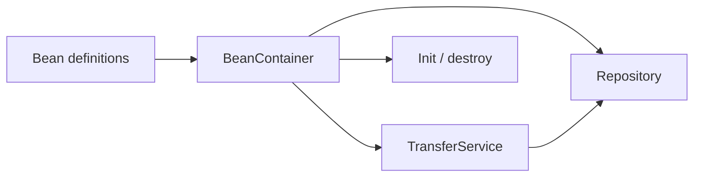

# Phase 08: Manual Dependency Injection Container

## Purpose and outcomes

Build a deliberately small IoC/DI container to understand registration, dependency resolution, scopes, reflection, and lifecycle callbacks.

## Place and prerequisites

Precedes Spring Core and does not recreate Spring. Start from Phase 7 and study tight/loose coupling, Dependency Inversion, constructor/setter injection, registries, reflection, scopes, and circular dependencies.

## Exercises

### 1. Registry

- Objective: register/retrieve objects by type.
- Tasks: create `BeanContainer`; register instances; retrieve services/repositories; fail clearly for unknown types.
- Acceptance: [ ] application obtains managed objects instead of constructing the full graph.

### 2. Constructor resolution

- Objective: resolve dependencies through constructors.
- Tasks: inspect constructors; recursively resolve dependencies; detect missing dependencies.
- Acceptance: [ ] constructor injection works; [ ] errors identify unresolved types.

### 3. Components and scopes

- Objective: explore discovery and identity.
- Tasks: add `@MyComponent`; discover classes; implement singleton and prototype; add lifecycle callbacks.
- Acceptance: [ ] singleton identity is stable; [ ] prototype identity differs; [ ] limitations are recorded.

### 4. Wire the banking graph

- Acceptance: [ ] service/repository graph is container-managed; [ ] ambiguity, configuration, and circular dependency limits are documented.

## Debugging, checklist, and transition

Trace registration, construction, lookup, and callbacks. Do not add field injection, proxies, broad scanning, or Spring-like feature parity.

- [ ] Constructor injection and scopes tested.
- [ ] Manual wiring versus DI note saved in `docs/comparison/`.
- [ ] Container diagram and limitations documented.

Spring now becomes useful because the manual container has exposed the problem. Phase 9 replaces it with Spring Core.

## Official references

- [Spring IoC container](https://docs.spring.io/spring-framework/reference/core/beans.html)
- [Dependency Inversion Principle](https://martinfowler.com/articles/dipInTheWild.html)
