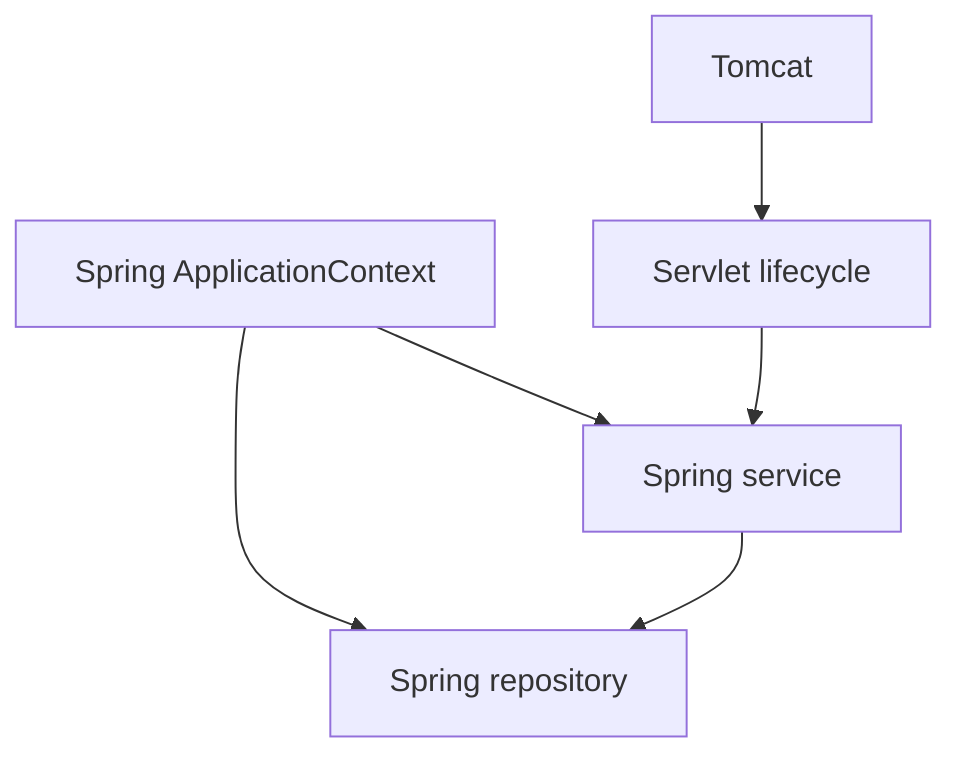

# Phase 09: Spring Core

## Purpose and outcomes

Replace the manual container with Spring IoC and understand registration, configuration styles, scopes, lifecycle, events, and container boundaries.

## Place and prerequisites

Requires Phase 8. Use Spring Framework 6.x and Java 21. Keep the Servlet web layer; do not introduce Spring Boot or Spring MVC yet.

## Topics and architecture

BeanFactory/ApplicationContext; XML, Java config, component scanning; `@Component`, `@Service`, `@Repository`, `@Configuration`, `@Bean`; constructor injection; scopes; callbacks; BeanPostProcessor; events; externalized configuration.

## Exercises

### 1. Bootstrap and configuration

- Objective: create an ApplicationContext.
- Tasks: register a service/repository using XML, Java configuration, and component scanning; compare definitions.
- Acceptance: [ ] each style produces working beans.

### 2. Injection and scopes

- Objective: observe resolution and identity.
- Tasks: use constructor injection; compare singleton/prototype; inspect BeanFactory versus ApplicationContext.
- Acceptance: [ ] dependencies are explicit; [ ] scope behavior is demonstrated.

### 3. Lifecycle, post-processing, and events

- Objective: understand extension points.
- Tasks: add init/destroy callbacks; implement a simple BeanPostProcessor; publish/listen for an event.
- Acceptance: [ ] callback/event order is documented.

### 4. Servlet integration

- Objective: integrate Spring services into Tomcat-managed Servlets.
- Acceptance: [ ] ownership of every object is documented; [ ] both lifecycles are traceable.

## Build, debug, and mistakes

Inspect bean definitions and startup logs. Watch for duplicate beans, ambiguous constructors, assumed prototype destruction, and confusion between Servlet and Spring lifecycles.

## Deliverables and checklist

- [ ] Three configuration styles compared.
- [ ] Scope/lifecycle/event experiments.
- [ ] Servlet/Spring ownership diagram.
- [ ] Spring-managed service/repository mini-project.

## Transition

Phase 10 replaces manual routing with Spring MVC while retaining the concepts learned here.

## Official references

- [Spring Core container](https://docs.spring.io/spring-framework/reference/core/beans.html)
- [Spring application events](https://docs.spring.io/spring-framework/reference/core/beans/context-introduction.html#context-functionality-events)
