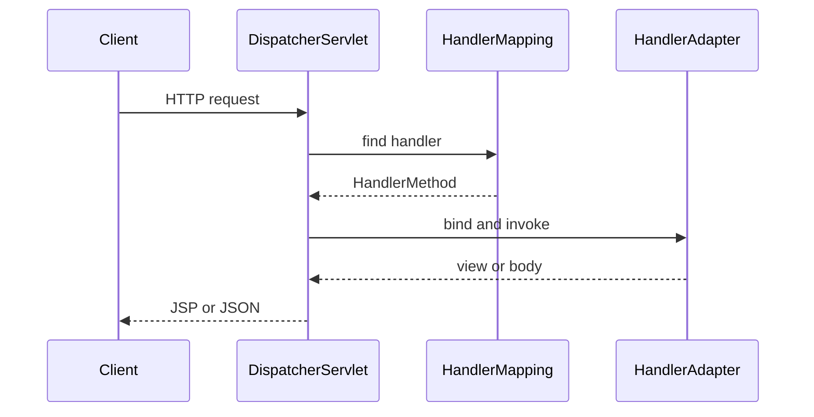

# Phase 10: Spring MVC

## Purpose and outcomes

Replace the manual dispatcher with framework-managed mapping, binding, view resolution, JSON conversion, validation, and centralized errors.

## Place and prerequisites

Requires Spring Core and Servlet/JSP foundations. Use Spring Framework 6.x; do not use Spring Boot yet.

## Topics and request flow

DispatcherServlet; HandlerMapping/HandlerAdapter; controllers and mappings; request parameters/path variables/forms/bodies; Model/ModelAndView; JSP ViewResolver; Jackson converters; validation; `@ControllerAdvice`; interceptors versus filters.

## Exercises

### 1. Controllers and mappings

- Objective: map customer/account operations.
- Tasks: configure DispatcherServlet; create controllers; implement GET/POST; bind query/path values.
- Acceptance: [ ] requests reach correct methods; [ ] conflicts are resolved intentionally.

### 2. Views and JSON

- Objective: compare server-rendered and message-body responses.
- Tasks: bind forms; return JSP views; return JSON; inspect HttpMessageConverter/Jackson selection.
- Acceptance: [ ] JSP and JSON endpoints are correct.

### 3. Validation and errors

- Objective: standardize invalid input and failures.
- Tasks: add validation; add `@ControllerAdvice`; compare an interceptor with a Servlet filter.
- Acceptance: [ ] invalid requests return useful errors; [ ] global handler is exercised.

### 4. Banking rebuild

- Acceptance: [ ] routing, binding, invocation, view resolution, and conversion are traceable in the working application and diagram.

## Build, debug, and checklist

Deploy the WAR, enable framework logs, and step through DispatcherServlet → HandlerMapping → HandlerAdapter → controller. Do not assume Spring MVC is Spring Boot.

- [ ] Customer/account controllers.
- [ ] JSP and JSON responses.
- [ ] Validation and global errors.
- [ ] Filter/interceptor comparison.

## Transition

Phase 11 simplifies configuration and deployment with Spring Boot, embedded Tomcat, profiles, and executable JARs.

## Official references

- [Spring MVC](https://docs.spring.io/spring-framework/reference/web/webmvc.html)
- [Spring validation](https://docs.spring.io/spring-framework/reference/core/validation/beanvalidation.html)
