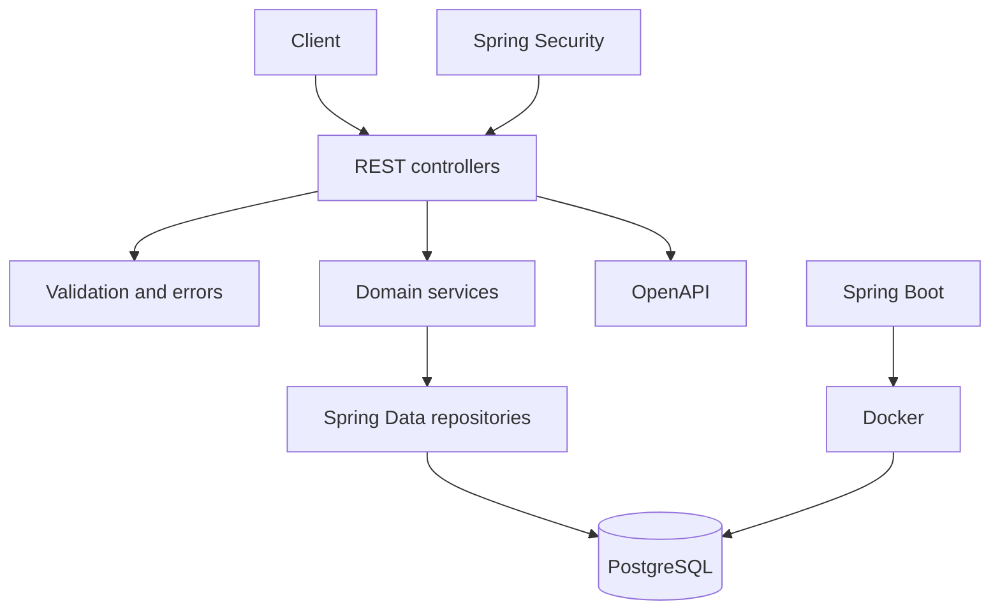

# Phase 12: Modern Spring Boot REST Application

## Purpose and outcomes

Build the capstone REST backend with DTOs, persistence, migrations, validation, security, tests, observability, OpenAPI, and Docker. Use fictional data only.

## Place and prerequisites

Requires Phase 11 and the full earlier progression. Never store real credentials, payment information, or secrets in source control.

## Topics and architecture

REST semantics; DTO/entity separation; Spring Data JPA/Hibernate; Flyway/Liquibase; Bean Validation; error responses; Spring Security; authentication/authorization; JWT concepts; structured logs/correlation IDs; unit/slice/integration tests; Testcontainers; OpenAPI; Docker Compose; secrets.

## Exercises

### 1. REST design and DTOs

- Objective: define stable resources and HTTP semantics.
- Tasks: design customer/account/transaction endpoints; create request/response DTOs; replace JSP calls with REST calls; map explicitly.
- Acceptance: [ ] URLs/status codes are documented; [ ] entities are not exposed directly.

### 2. Persistence and migrations

- Objective: establish a production-oriented persistence boundary.
- Tasks: integrate Spring Data JPA; add migrations; configure PostgreSQL; preserve atomic transfers.
- Acceptance: [ ] clean database can be created from migrations; [ ] transfer remains atomic.

### 3. Validation and errors

- Objective: make API failures predictable.
- Tasks: add Bean Validation; implement stable error fields/messages and a correlation ID; hide internal details.
- Acceptance: [ ] invalid requests return documented errors.

### 4. Security

- Objective: protect resources.
- Tasks: configure Spring Security; use fictional authentication; apply role rules; study safe JWT handling.
- Acceptance: [ ] protected endpoints reject anonymous users; [ ] authorization rules are tested; [ ] secrets remain external.

### 5. Tests and operations

- Objective: verify and operate the API.
- Tasks: write service unit tests, controller/repository slice tests, PostgreSQL integration tests, optional Testcontainers tests; generate OpenAPI; add structured logs/correlation IDs.
- Acceptance: [ ] success/failure are covered; [ ] API is documented; [ ] logs support tracing.

### 6. Containerization

- Objective: package reproducibly.
- Tasks: create Dockerfile; create Compose for app/PostgreSQL; document configuration and secret management.
- Acceptance: [ ] clean environment starts app and database; [ ] no secret is baked into the image.

## Build, debug, and common mistakes

Run unit tests before integration tests, inspect migrations and SQL, reproduce calls from OpenAPI, and test multiple fictional roles. Avoid exposing entities, skipping migrations, logging tokens, or treating JWT as authorization itself.

## Deliverables and completion checklist

- [ ] Documented REST API for customers, accounts, transactions.
- [ ] PostgreSQL persistence with migrations.
- [ ] Validation, consistent errors, authentication, authorization.
- [ ] Unit, slice, and integration tests.
- [ ] OpenAPI, structured logs, Dockerfile, Compose, and configuration guide.

## Final reflection and success criteria

Explain how the final controller, security, repository, and transaction behavior relate to Servlet, JDBC, MVC, and DI mechanisms from earlier phases. Completion means the API runs in Docker, persists safely, is tested, documented, and its abstractions can be traced backward.

## Official references

- [Spring Boot](https://docs.spring.io/spring-boot/docs/current/reference/html/)
- [Spring Data JPA](https://docs.spring.io/spring-data/jpa/reference/)
- [Spring Security](https://docs.spring.io/spring-security/reference/)
- [Flyway](https://documentation.red-gate.com/flyway)
- [Docker](https://docs.docker.com/)
